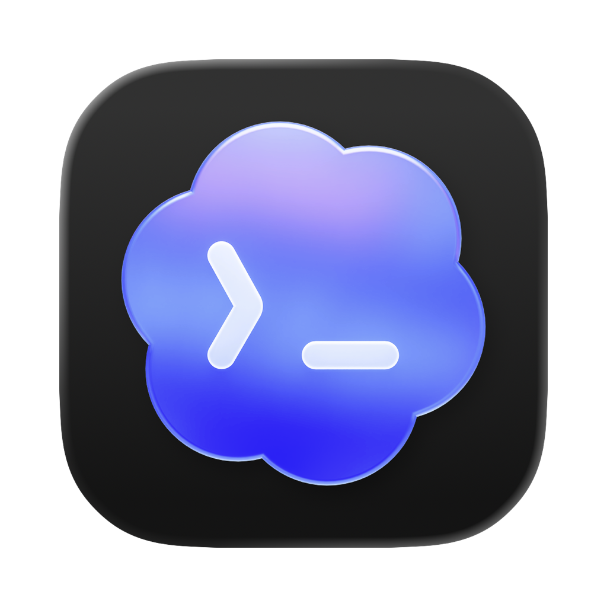

<p align="center">
  
</p>

<h1 align="center">AI Usage Monitor</h1>

<p align="center">Track your ChatGPT and Claude subscription limits from your desktop.</p>

<p align="center">
  Windows x64 · Linux x64 · Electron + React + TypeScript
</p>

<p align="center">
  <a href="#getting-started">Getting started</a> ·
  <a href="#provider-support">Provider support</a> ·
  <a href="#development">Development</a> ·
  <a href="https://github.com/Bhbored/AI-Sub-Manager/issues">Issues</a>
</p>

## What it does

| | Feature |
| --- | --- |
| 📊 | **Usage and resets.** See reported 5-hour and weekly limits, reset countdowns, and the last available reading. |
| 📅 | **Renewal dates.** Set your own plan name, renewal date, and billing cycle in Settings. |
| 🖥️ | **Three window modes.** Use the compact dashboard, maximize it within the desktop work area, or pin a top-right widget. |
| 🔄 | **Background monitoring.** Refresh on demand or on a schedule. Close the window to keep monitoring from the system tray. |
| 🗂️ | **Explore local profiles.** Browse project history and its disk usage, installed skills and plugins, MCP servers, and provider configuration. |

## Getting started

1. Check [GitHub Releases](https://github.com/Bhbored/AI-Sub-Manager/releases) for an installer. Build from source using the commands below if your platform has no published package.
2. Install the official CLI for each provider you want to monitor and sign in with the command in the table below. Run the CLI's `--version` command from a fresh terminal to confirm it is available.
3. Open the dashboard and select **Refresh**. Set your refresh interval, subscription renewal dates, and launch preferences in **Settings**.

If a CLI is missing from the dashboard, check `where.exe codex` or `where.exe claude` on Windows, or `command -v codex` or `command -v claude` on Linux. After changing PATH, choose **Quit** in the tray menu and reopen the app. The Windows app needs the Windows CLI, even if you also use a copy inside WSL.

## Provider support

| Provider | Sign in | Usage source |
| --- | --- | --- |
|  **OpenAI Codex** | `codex login` | Subscription windows reported by the Codex app-server. |
|  **Claude Code** | `claude auth login` | The Claude Code status line reports usage after the first response in a subscriber session. The collector needs `node` on PATH. |

The monitor uses your existing CLI profiles. Preferences and cached readings stay in local SQLite storage. Claude Code keeps an existing custom status line, and you can wire the collector into it manually. [Provider setup and architecture](docs/provider-integrations.md)

### Desktop behavior

Use **F11** to expand the dashboard and **Esc** to restore the compact window. The pin button switches to the widget. On Linux with native Wayland, the compositor controls widget placement. GNOME may require an AppIndicator extension to show the tray icon. [Linux desktop details](docs/packaging.md#linux-debian-and-ubuntu)

## Development

Use Node.js 24 and npm.

```bash
git clone https://github.com/Bhbored/AI-Sub-Manager.git
cd AI-Sub-Manager
npm ci
npm run dev
```

| Command | Purpose |
| --- | --- |
| `npm run typecheck` | Check the desktop, renderer, test, and release tool types. |
| `npm test` | Run the automated test suite. |
| `npm run build` | Compile Electron and build the renderer. |
| `npm run dist:windows -- --x64` | Build a per-user NSIS installer under `release/`. Run on Windows. |
| `npm run dist:linux` | Build a Debian/Ubuntu `.deb` and portable AppImage under `release/linux/`. Run on Linux or WSL. |

Packaging also writes release notes and SHA-256 checksums. [Packaging, signing, and smoke tests](docs/packaging.md) · [Versioning](docs/versioning.md) · [Source layout](docs/source-layout.md)

## Contributing

Open an issue with your OS, app version, provider CLI version, and steps to reproduce. Keep credentials and private conversation history out of reports. For a pull request, describe the change and how you tested it.
